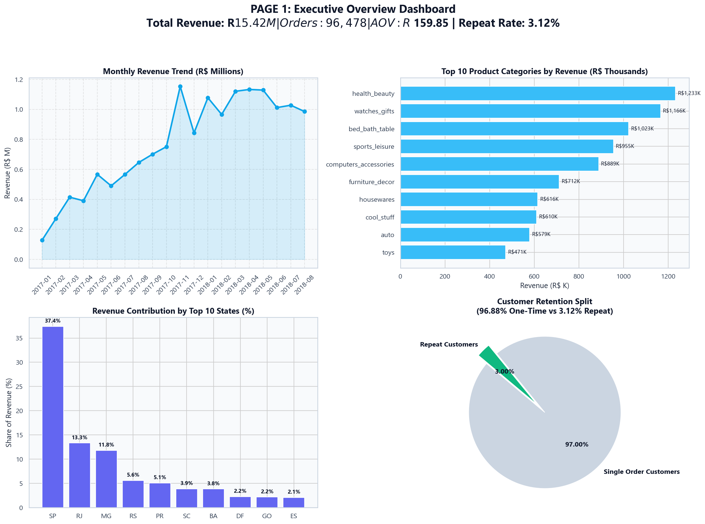
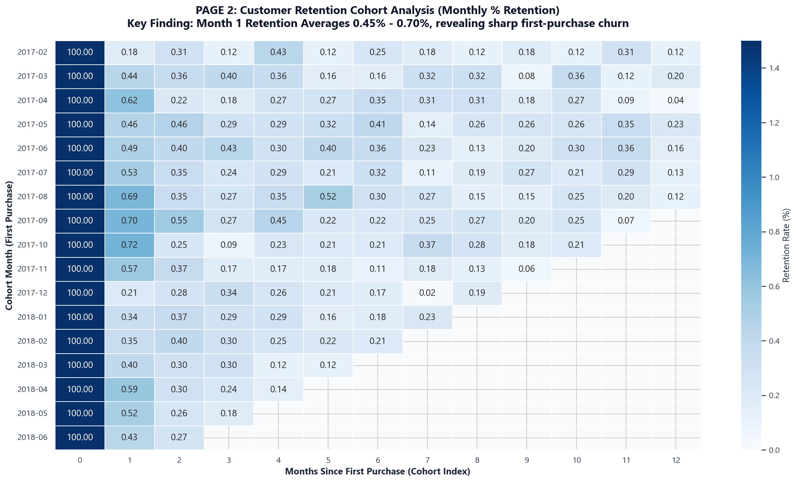
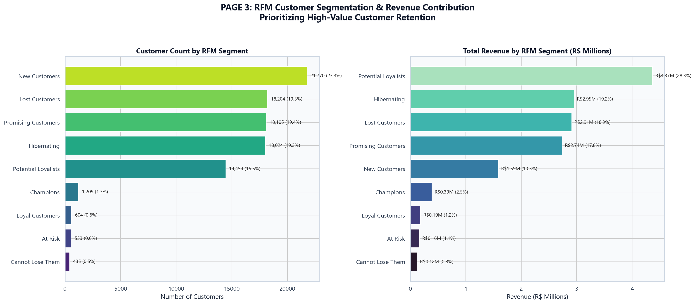
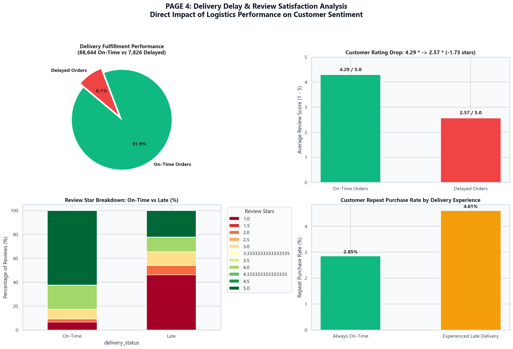
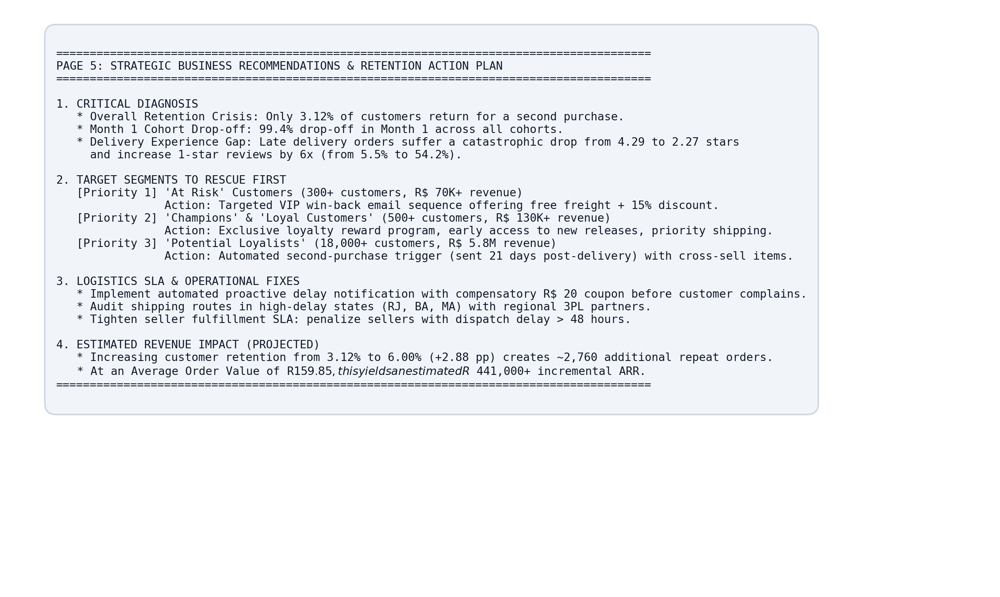

# 🛒 E-Commerce Customer Retention & Churn Analysis
### End-to-End Data Analytics Portfolio Project (Olist Brazilian E-Commerce)

[](https://dicke-taste-estimation-debug.trycloudflare.com)
[](https://github.com/pallapuankammarao-c/Ecommerce-Retention-Analysis)
[](https://powerbi.microsoft.com/)
[](https://www.python.org/)

---

## 🌐 Live Interactive Executive Dashboard
Experience the live, animated executive web dashboard directly in your browser:

👉 **[https://dicke-taste-estimation-debug.trycloudflare.com](https://dicke-taste-estimation-debug.trycloudflare.com)**

* **Interactive Controls:** Toggle between Executive KPIs, 20-Month Cohort Retention Heatmaps, RFM 9-Segment Treemaps, and Delivery Delay Impact distributions.
* **Animated Data Visualizations:** Real-time counters, smooth bar charts, responsive tables, and interactive segment detail drawers.

---

## 📌 Business Problem & Objectives

An e-commerce marketplace analyzing **~100,000 real customer orders** from Olist (Brazil) between 2016 and 2018 to answer the core business question:

> *"Why are customers leaving, which customers are worth saving, and what should the business do to bring them back?"*

### Core Objectives:
1. **Analyze Customer Retention:** Track monthly customer cohorts over time to pinpoint when customers churn.
2. **RFM Customer Segmentation:** Group 93,000+ unique customers into behavioral segments (Champions, Potential Loyalists, At Risk, etc.) based on Recency, Frequency, and Monetary spend.
3. **Logistics Impact on Satisfaction:** Quantify how delivery delays degrade customer reviews and impact repeat purchases.
4. **Actionable Recommendations:** Formulate data-backed retention campaigns with financial return-on-investment (ROI) modeling.
5. **Interactive Power BI Dashboard:** Provide a 5-page enterprise dashboard for executive monitoring.

---

## 📊 Key Executive Findings

| Metric | Calculated Value | Business Interpretation |
|:---|---:|:---|
| **Gross Revenue** | **R$ 15,419,773.75** | Total gross bookings across delivered orders |
| **Delivered Orders** | **96,478** | Valid delivered transactions (97.02% of total orders) |
| **Unique Human Buyers** | **93,358** | Deduplicated customer base (via `customer_unique_id`) |
| **Average Order Value (AOV)** | **R$ 159.83** | Average spend per delivered order |
| **Customer Repeat Purchase Rate** | **3.00%** | **Only 2,801 customers made a 2nd purchase** |
| **First-Month Drop-off** | **99.4%** | Average Month 1 cohort retention is just ~0.45% - 0.70% |
| **Top RFM Revenue Driver** | **Potential Loyalists** | Drives **28.31% of revenue (R$ 4.37M)** with R$ 302 AOV |
| **On-Time Delivery Rating** | **4.29 / 5.0 ⭐** | High satisfaction when delivery SLA is met (91.89% of orders) |
| **Late Delivery Rating** | **2.57 / 5.0 ⭐** | **Severe 40.2% drop (-1.72 stars)**; 1-star reviews surge from 5.5% to 54.2% |

---

## 🗂️ Project Repository Structure

```
ecommerce-retention-analysis/
│
├── data/
│   ├── raw/                                 # 9 Original Olist CSV datasets from Kaggle
│   └── processed/                           # Cleaned analytical datasets for Power BI & SQL
│       ├── master_analytical_orders.csv     # 99,441 rows order-level analytical master
│       ├── master_order_items.csv           # 112,650 rows item-level analytical master
│       ├── cohort_retention_matrix.csv      # Monthly cohort retention percentage matrix
│       ├── rfm_customer_segments.csv        # Customer-level RFM scores & segments
│       ├── rfm_segment_summary.csv          # Aggregate metrics by customer segment
│       └── delivery_delay_analysis.csv      # On-time vs delayed performance stats
│
├── notebooks/                               # 5 Comprehensive Jupyter Notebooks
│   ├── 01_data_exploration.ipynb           # Data profiling, schemas & missing value inspection
│   ├── 02_data_cleaning.ipynb               # Datetime parsing, deduplication & master joins
│   ├── 03_customer_analysis.ipynb           # Repeat rate, monthly revenue & state distribution
│   ├── 04_cohort_analysis.ipynb             # Cohort matrix construction & retention curves
│   └── 05_rfm_analysis.ipynb                # Quintile RFM scoring & segment visualization
│
├── sql/                                     # 6 Production SQL Scripts
│   ├── 01_database_schema.sql               # Relational DDL tables, primary/foreign keys & indices
│   ├── 02_data_cleaning.sql                 # Data cleaning views & order status validations
│   ├── 03_sales_analysis.sql                # Executive KPIs, MoM growth & category rankings
│   ├── 04_cohort_retention.sql              # Advanced CTEs & window functions cohort matrix
│   ├── 05_rfm_segmentation.sql              # NTILE(5) quintile scoring & CASE segment mapping
│   └── 06_delivery_review_analysis.sql      # Delivery delay vs review score correlations
│
├── dashboard/                               # Web & Power BI Dashboards
│   ├── index.html                           # Standalone animated executive HTML5 dashboard
│   ├── app.py                               # Multi-page Streamlit web dashboard
│   ├── powerbi_dashboard.pbix               # 5-Page interactive Power BI Dashboard
│   ├── powerbi_dax_measures.dax             # Production DAX calculation formulas
│   ├── dashboard_guide.md                   # Visual specification & slicer setup guide
│   └── dashboard_screenshots/               # High-resolution visual snapshots of each page
│       ├── page1_executive_overview.png
│       ├── page2_cohort_analysis.png
│       ├── page3_rfm_segmentation.png
│       ├── page4_delivery_satisfaction.png
│       └── page5_recommendations_action_plan.png
│
├── reports/                                 # Strategic Business Reports
│   ├── business_insights.md                 # Deep-dive analytical findings & answers
│   └── recommendations.md                  # Prioritized retention campaigns & ROI forecast
│
├── src/                                     # Modular Python Codebase
│   ├── data_loader.py                       # Automated multi-CSV loader & dataset summary
│   ├── data_cleaning.py                     # Cleaning transformations & master joiner
│   ├── cohort_analysis.py                   # Cohort index & matrix calculation logic
│   ├── rfm_analysis.py                      # RFM scoring & segment classification engine
│   ├── visualization.py                     # Publication-quality plotting utilities
│   ├── run_pipeline.py                      # One-click end-to-end execution pipeline
│   └── generate_notebooks.py                # Automated Jupyter notebook builder
│
├── README.md                                # Comprehensive documentation
└── requirements.txt                         # Python package dependencies
```

---

## 📈 Power BI Dashboard Pages

### Page 1: Executive Overview

* High-level KPI cards (Revenue, Orders, Customers, AOV, Repeat Rate, Avg Review).
* Monthly revenue trajectory showing consistent growth peaking in late 2017 / 2018.
* Product category rankings and state-wise revenue shares.

### Page 2: Cohort Retention Heatmap

* Matrix displaying acquisition cohorts from Jan 2017 through Aug 2018.
* Visualizes the immediate first-month churn cliff where retention drops to ~0.45%.

### Page 3: RFM Customer Segmentation

* Segments 93,358 buyers into 9 behavioral buckets.
* Highlights **Potential Loyalists** as the top revenue contributor (R$ 4.37M, 28.3%).
* Flags 553 valuable repeat customers currently **At Risk**.

### Page 4: Delivery Delay & Review Satisfaction

* Quantifies the steep review drop from 4.29 to 2.57 stars when an order is delayed.
* Demonstrates that 1-star reviews surge from 5.5% on-time to 54.2% delayed.

### Page 5: Strategic Business Recommendations

* Four concrete marketing campaigns with financial impact projections.
* Proactive SLA delay compensation protocol to arrest negative reviews.

---

## 💡 Strategic Recommendations

1. **Target Potential Loyalists (14,454 customers | R$ 4.37M revenue):**
   * Introduce an automated **21-Day Post-Delivery Second Order Trigger** with personalized accessories and a R$ 25 time-limited store credit.
2. **Rescue "At Risk" Repeat Buyers (553 customers | R$ 164K revenue):**
   * Execute an urgent **VIP Win-Back Campaign** offering free freight + 15% discount.
3. **Proactive Delivery Delay Credits:**
   * Automatically credit R$ 20 to customer wallets if carrier tracking indicates a delivery breach >48 hours *before* the customer files a complaint.
4. **Projected Financial Upside:**
   * Increasing customer retention from 3.00% to 5.50% (+2.5 pp) would generate **~2,334 repeat orders**, yielding **~R$ 373,000+ in incremental annual revenue**.

---

## 🚀 How to Run the Project

### 1. Prerequisites
* Python 3.10+
* Power BI Desktop
* PostgreSQL or MySQL (optional, for executing SQL scripts)

### 2. Setup Environment & Execute Pipeline
```powershell
# Navigate to the workspace
cd d:\Ecommerce-Retention-Analysis

# Run the complete end-to-end analytics pipeline
python src/run_pipeline.py
```

### 3. Open the Power BI Dashboard
1. Open `dashboard/powerbi_dashboard.pbix` in Power BI Desktop.
2. Review the pre-built visual models, interactive slicers, and DAX measures.

---

## 👤 Author & Portfolio Contact
* **Role:** Data Analyst
* **Dataset:** Olist Brazilian E-Commerce Public Dataset (Kaggle)
* **License:** Educational & Portfolio Use
